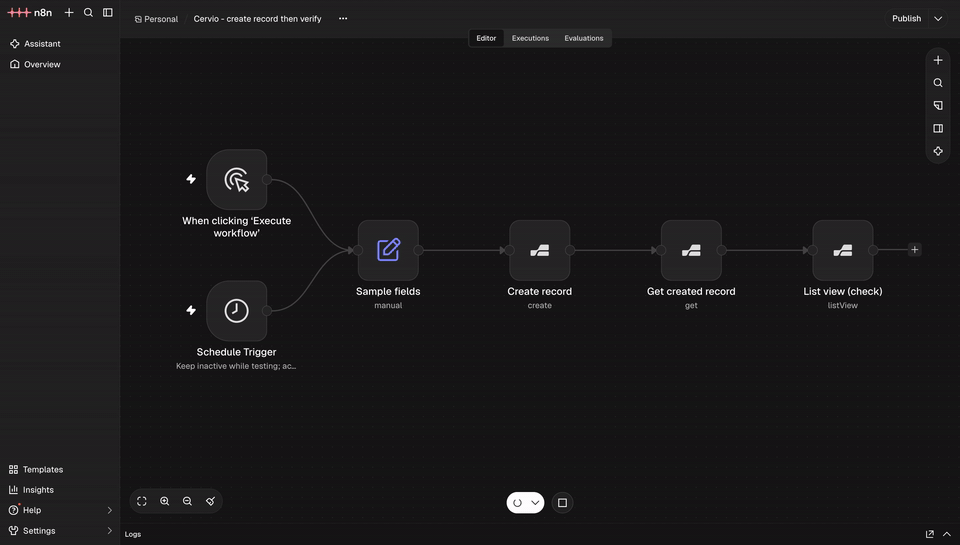

# @cervio/n8n-nodes-cervio

[](https://www.npmjs.com/package/@cervio/n8n-nodes-cervio)
[](./LICENSE.md)



Official [n8n](https://n8n.io/) community node for [Cervio](https://cervio.app).

Connect n8n workflows to a Cervio tenant over the public REST API (`/api/v1`): entity records, documents, N:M links, upsert/resolve, and workflows. Field lists for create/update come from the form write-schema (resource mapper), not a free-form JSON body. The node is marked `usableAsTool: true` for n8n AI Agent tools.

| | |
|--|--|
| **npm** | [`@cervio/n8n-nodes-cervio`](https://www.npmjs.com/package/@cervio/n8n-nodes-cervio) |
| **Source** | [github.com/cervio-app/n8n-nodes-cervio](https://github.com/cervio-app/n8n-nodes-cervio) |
| **Node type** | `@cervio/n8n-nodes-cervio.cervio` |

> **Migration:** the unscoped package `n8n-nodes-cervio` is deprecated. Install `@cervio/n8n-nodes-cervio` and re-select the Cervio credential / node if n8n cached the old type name.

## Prerequisites

- Node.js **≥ 20**
- An **n8n** instance (self-hosted, desktop, or Cloud with community packages enabled)
- A Cervio **Personal Access Token** (`cpat_…`) from **Admin → API**
- External API access enabled for the organization

## Installation

### n8n UI (recommended)

1. Open **Settings → Community nodes**
2. Install `@cervio/n8n-nodes-cervio`
3. Restart n8n if prompted

### npm + custom folder

```bash
npm install -g @cervio/n8n-nodes-cervio

mkdir -p ~/.n8n/custom
cd ~/.n8n/custom
npm link @cervio/n8n-nodes-cervio
```

Restart n8n, then add the **Cervio** node from the palette.

### From source

```bash
git clone https://github.com/cervio-app/n8n-nodes-cervio.git
cd n8n-nodes-cervio
npm install && npm run build
npm link

mkdir -p ~/.n8n/custom && cd ~/.n8n/custom
npm link @cervio/n8n-nodes-cervio
```

### Docker Compose (local smoke)

```bash
npm run build
docker compose up
# → http://localhost:5678
```

## Credentials

Create a **Cervio API** credential in n8n:

| Field | Example | Notes |
|-------|---------|--------|
| **Base URL** | `https://acme.cervio.app` | Tenant host only — required, no default |
| **Personal Access Token** | `cpat_…` | From Cervio **Admin → API** |

All operations use this credential.

## Operations

| Group | Operation | Description |
|-------|-----------|-------------|
| **Records** | Create / Update / Get / Delete | CRUD through an assigned form mask |
| | Upsert | Natural-key create-or-update (`match_field`) |
| | Validate draft | Dry-run formulas / required fields |
| | List view | Read via an assigned list view (cursor pages) |
| | List records | Admin entity list with `filter[field]=eq.value` |
| **Relations** | Search relation | Browse/search relation candidates (`q`, limit ≤ 100) |
| | Resolve relation | Match scalar keys → record UUIDs |
| | Link / Unlink | N:M through-field links |
| **Documents** | List / Upload / Open | Metadata, multipart upload, signed URL |
| | Generate | Render a mapped document template (admin) |
| **Workflows** | Start / Get run | Manual start + admin run status |

**Notes**

- **Create / Update / Upsert / Validate:** pick **Entity → Form**, then the resource mapper.
- N:M **through** fields are not on the mapper — use **Link / Unlink**.
- Relation dropdowns are capped (~50); use **Search relation** for larger sets.
- List view defaults: options = slugs, relations = UUIDs (ready for Update).

## Permissions

There is **no n8n-specific ACL** in Cervio. The node is a REST client; Cervio applies **two layers**. Both must allow the call.

```text
n8n  ──Bearer cpat_…──►  1) PAT scopes (Admin → API)
                              │  fail → 401 / scope error
                              ▼
                         2) User who owns the PAT (same ACL as UI)
                              │  fail → 403 / 404 / empty / validation
```

### Token scopes

| Scope | Used for |
|-------|----------|
| `records:read` | Get, List view/records, Search/Resolve, List/Open documents |
| `records:write` | Create, Update, Delete, Upsert, Validate, Upload, Link/Unlink, Start workflow |
| `admin:read` | Form / view / workflow dropdowns, Get workflow run |
| `admin:write` | Generate document from template |

`*:write` implies the matching `*:read`. Scopes alone do **not** grant row access or `can_create`.

### User behind the PAT

The PAT impersonates its owner (entity permissions, record policies, field denials, form/view assignments, document capabilities, manual-workflow trigger ACL) — same as the UI.

| Setup | PAT owner | Scopes |
|-------|-----------|--------|
| Full guided UX | `system_admin` | `admin:read`, `admin:write`, `records:read`, `records:write` |
| Narrow sync | Service user with entity ACL + assigned views/forms | `records:read` / `records:write` only |

## Compatibility

| | |
|--|--|
| n8n | Community nodes API v1 (`n8nNodesApiVersion: 1`) |
| Node.js | ≥ 20 (build / smoke) |
| Cervio | Tenant with `/api/v1` and External API enabled |

## Development

```bash
npm install
npm run build
npm test
npm run verify
npm run lint
```

Conventions, SemVer tags (`vX.Y.Z`), and publish steps: [CONTRIBUTING.md](./CONTRIBUTING.md).

Live smoke (optional):

```bash
export CERVIO_BASE_URL=https://YOUR_TENANT.cervio.app
export CERVIO_PAT=cpat_…
npm run smoke
npm run smoke:extended
```

## Known limits

- List records without a view is admin-only — prefer **List view**
- Nested child create = two Creates (parent, then child with FK)
- Generate document needs a mapped template UUID (no public template catalog yet)
- List view “all pages”: max 10 × 500 rows

## References

- [Cervio](https://cervio.app)
- [n8n community nodes](https://docs.n8n.io/integrations/community-nodes/)
- Tenant OpenAPI: `public/openapi/v1.yaml` in the Cervio app repo

## License

[MIT](./LICENSE.md)
